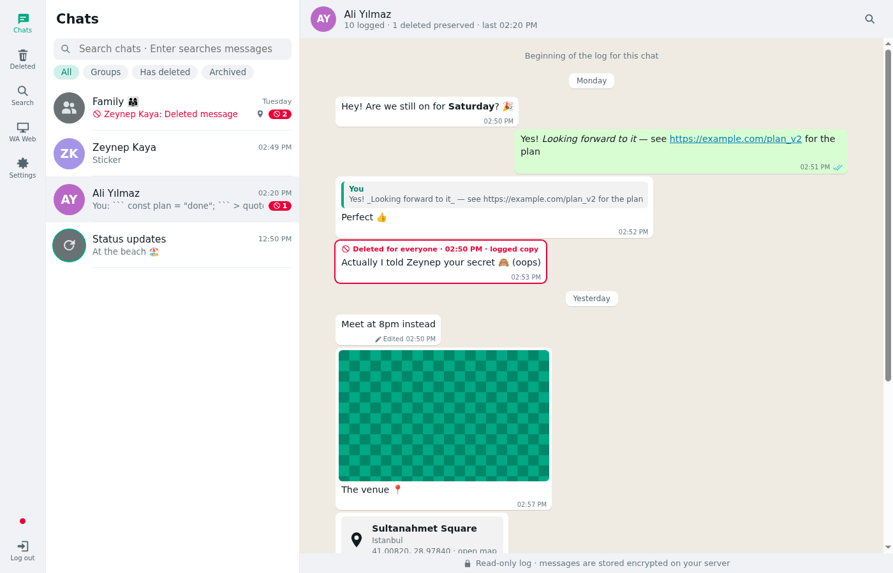
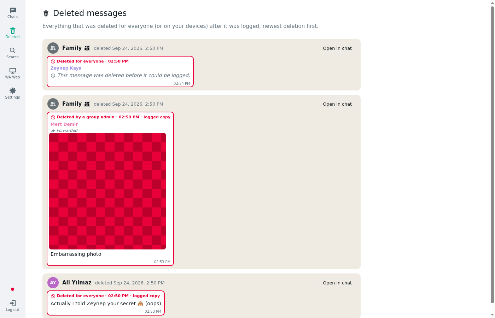
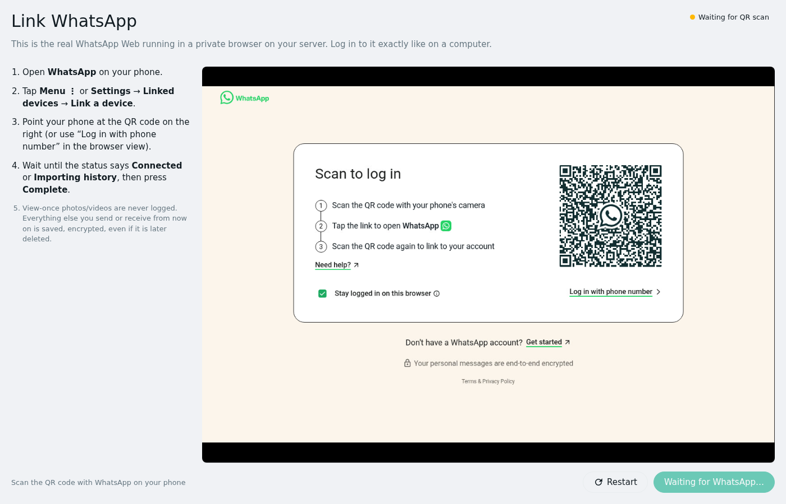
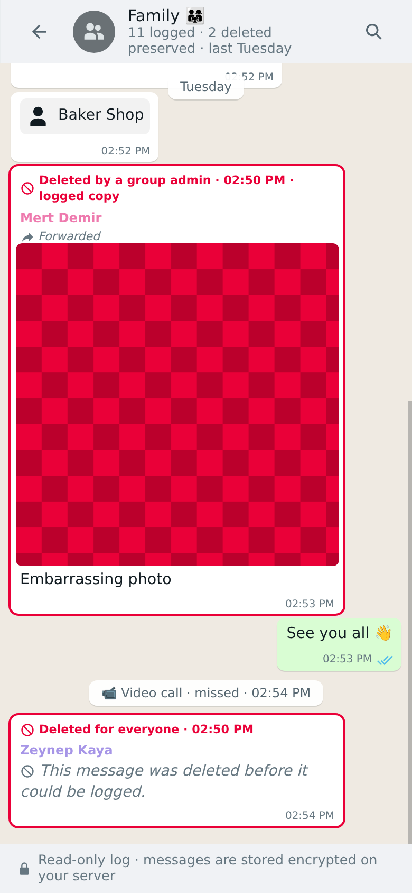

# wa_logger

Self-hosted, **encrypted WhatsApp message logger** with a WhatsApp-like web UI.

wa_logger runs the real WhatsApp Web inside a sandboxed Chromium container on your own server, records every
message, photo, video, voice note, document, edit and reaction your account sends or receives, and keeps it
**even after the sender deletes it**. You read everything in a WhatsApp-style web interface, and you can **send** from
it too: text, replies, photos, videos, files, voice notes, reactions, edits and "delete for everyone". You can also
make and take **voice and video calls** from the browser, and open the live WhatsApp Web session from the menu (**WA Web**).

<p>
  
  
</p>
<p>
  
  
</p>

_(Screenshots show generated demo data.)_

## Features

- **Anti-delete:** messages deleted for everyone (or deleted by a group admin) stay readable and are flagged in red.
  A dedicated **Deleted** page lists every deletion.
- **Edit history:** every earlier version of an edited message is kept.
- **Send messages** as your account: text (Enter sends, Shift+Enter is a new line), replies, photos and videos with a
  caption, any file up to 64 MB, voice notes (needs HTTPS for the microphone), reactions, editing your messages
  (within WhatsApp's 15 minutes) and deleting them for everyone, and new chats by phone number (**+** above the chat
  list). Sending goes through the linked WhatsApp Web session with WhatsApp Web's own send functions, and everything
  you send is logged like any other message. Read receipts are off unless you turn them on (Settings → Logging);
  replying in a chat marks it as read, as in WhatsApp.
- **Voice and video calls** from the browser: the phone and camera buttons in a one-to-one chat call the contact, and
  incoming calls ring in every open wa_logger tab (Answer / Answer with video / Decline, mute, camera on/off, hang up).
  Video calls get a full-screen view with your camera in the corner. The call runs in the linked WhatsApp Web session, with
  WhatsApp Web's own calling; your browser's microphone, speakers and camera are bridged to it over the authenticated
  connection. Needs HTTPS (browsers only allow the microphone and camera there); video needs a browser with WebCodecs
  (current Chrome, Edge, Safari or Firefox). Calls are **not recorded unless you ask**: the record button in the call panel (or **Settings → Logging → Record calls automatically**, off by default) saves the call — both voices mixed, plus the other side's picture in video calls — as an encrypted MP4 listed under **Calls**. Make sure the other person agrees: recording without consent is not allowed everywhere. Group calls can be answered but not started.
- **All message types** are logged except view-once media: text with WhatsApp formatting, photos, videos,
  GIFs, voice notes, audio, documents, stickers, locations, contact cards, polls, calls, group events, reactions,
  replies, forwards and status updates (optional).
- **Media is downloaded immediately**, before it can be deleted. Large videos stream to disk in chunks, and playback
  supports seeking (HTTP Range).
- **Search** across all decrypted messages, globally or per chat.
- **WA Web** menu item shows the live background browser (noVNC), view-only by default.
- **Multiple users:** the first account is the admin and adds more users (**Users** menu). Each person gets their own WhatsApp
  link and QR code, their own encrypted data and keys, and their own browser; the admin sees names and status, never
  messages. A new user signs in with a temporary password and must choose their own. The admin can put each user on a
  **different port**, so your address can sit behind a login proxy such as authentik while a friend's address doesn't.
  See [Multiple users](#multiple-users).
- **Live updates** (Server-Sent Events), light and dark themes, and a mobile layout.

**View-once photos and videos are not logged, by design.** They appear only as a placeholder.

## Security at a glance

This app handles private messages, so security was the primary design constraint. See [SECURITY.md](SECURITY.md)
and [ARCHITECTURE.md](ARCHITECTURE.md) for details.

- **Encryption at rest with your password.** Message text, names, thumbnails and every media file are encrypted
  (AES-256-GCM) under data keys that are wrapped to an X25519 key pair. The private key itself is encrypted with
  your password (scrypt). The logger can *write* while you are logged out, but a stolen database, media folder
  or backup **cannot be read** without your password or recovery key.
- **Accounts.** The first signup needs the one-time `SETUP_TOKEN` from `.env` and creates the admin; signup then closes.
  Other users are created by the admin and choose their own password at their first sign-in. Optional **TOTP 2FA**, a
  recovery key, per-account lockout, rate limits and an audit log are included.
- **Isolation between users.** Every user is a separate tenant: own database and keys, own worker process and own Chromium,
  each under a **different unix user** in `0700` directories, with no way to reach each other's files, sockets or
  browsers. A stolen password or a compromised account opens that one account only. See SECURITY.md.
- **Hardened sessions.** `__Host-` cookies (`Secure`, `HttpOnly`, `SameSite=Strict`) plus Origin and CSRF-token
  checks, with idle and absolute expiry. Sessions can be listed and revoked, including "log out everywhere".
- **Strict CSP** (no inline scripts, no third-party resources). Message content is never rendered as HTML.
  Attacker-sent files are served with a sandbox CSP and as downloads unless they are safe image, audio or video types.
- **Isolated containers.** The app container has **no internet access**. Only Chromium can reach WhatsApp, and its
  remote-debugging and VNC ports are never exposed: the only way to a browser is a token-checked manager on an internal
  Docker network. Chromium keeps its **sandbox on** (through a custom seccomp profile) and a policy blocks navigation
  to any site except WhatsApp, as well as downloads, uploads and extensions. All containers have read-only root
  filesystems, `cap_drop: ALL` and `no-new-privileges`; the two that start one process per user (app and chromium) keep
  four capabilities (`SETUID SETGID CHOWN KILL`) in a small root supervisor that hands nothing on.

> ⚠️ wa_logger uses an unofficial WhatsApp Web client (`whatsapp-web.js`). Automating WhatsApp may break its Terms of
> Service and could get the account restricted. Use it only for your own account and at your own risk. Laws about
> recording communications differ by country.

## Requirements

- Linux host with **Docker Engine 24+** and the **compose plugin** (v2).
- 2 GB RAM minimum (**4 GB recommended**). Chromium with WhatsApp Web uses about 0.5–1 GB.
- x86_64 (arm64 should work but is untested).
- Proxmox/LXC works. The container needs `nesting=1` (and `keyctl=1` if unprivileged) so Docker can run inside it.

## Install (Docker Compose)

There are two ways to deploy. Both give you the same three containers (`caddy`, `app` and `chromium`) and the same security settings.

### Option A: prebuilt images (no clone, no build)

Images are published to GitHub Container Registry by CI:
`ghcr.io/revocx35/wa_logger-app`, `…-chromium` and `…-caddy`, tagged `latest`, `x.y.z` and `sha-…`.

```bash
mkdir wa_logger && cd wa_logger
curl -fsSLO https://raw.githubusercontent.com/revocx35/wa_logger/main/deploy/docker-compose.yml
curl -fsSLO https://raw.githubusercontent.com/revocx35/wa_logger/main/chromium/seccomp-chromium.json
curl -fsSLO https://raw.githubusercontent.com/revocx35/wa_logger/main/scripts/setup.sh
bash setup.sh --site 192.168.1.50     # your server's IP or domain; writes .env with random secrets
docker compose up -d
```

The folder then contains exactly these files:

```
wa_logger/
├── docker-compose.yml       # below
├── seccomp-chromium.json    # Docker's default seccomp profile + what Chromium's sandbox needs
├── setup.sh                 # only needed once
└── .env                     # generated secrets and settings (chmod 600)
```

<details>
<summary><b>Example <code>docker-compose.yml</code></b> (same as <a href="deploy/docker-compose.yml">deploy/docker-compose.yml</a>)</summary>

```yaml
# wa_logger — standalone deployment with prebuilt images (no git clone, no build).
#
#   mkdir wa_logger && cd wa_logger
#   curl -fsSLO https://raw.githubusercontent.com/revocx35/wa_logger/main/deploy/docker-compose.yml
#   curl -fsSLO https://raw.githubusercontent.com/revocx35/wa_logger/main/chromium/seccomp-chromium.json
#   curl -fsSLO https://raw.githubusercontent.com/revocx35/wa_logger/main/scripts/setup.sh
#   bash setup.sh --site 192.168.1.50        # writes .env with random secrets (see README)
#   docker compose up -d
#
# Services:
#   caddy    : TLS termination, the only service with published ports
#   app      : Node server + web UI (no internet access: internal networks only)
#   chromium : WhatsApp Web in a sandboxed, policy-locked Chromium (only this talks to WhatsApp)
# Pin a release with WAL_VERSION=x.y.z in .env (default: latest).

name: wa_logger

x-logging: &logging
  driver: json-file
  options:
    max-size: "10m"
    max-file: "3"

x-hardening: &hardening
  read_only: true
  cap_drop: [ALL]
  security_opt:
    - no-new-privileges:true
  logging: *logging

services:
  caddy:
    image: ghcr.io/revocx35/wa_logger-caddy:${WAL_VERSION:-latest}
    restart: unless-stopped
    <<: *hardening
    cap_add: [NET_BIND_SERVICE]
    ports:
      - "${HTTP_BIND:-0.0.0.0}:${HTTP_PORT:-80}:80"
      - "${HTTPS_BIND:-0.0.0.0}:${HTTPS_PORT:-443}:443"
      # Extra ports for users the admin keeps off the default port (user management). Closed to the network by default:
      # set EXTRA_BIND=0.0.0.0 (or your LAN address) when the reverse proxy for those users runs on another host.
      - "${EXTRA_BIND:-127.0.0.1}:${EXTRA_PORTS:-8101-8110}:${EXTRA_PORTS:-8101-8110}"
    # Caddyfile = HTTPS (Let's Encrypt / internal CA); Caddyfile.http = plain HTTP behind your own TLS proxy.
    command: ["caddy", "run", "--config", "/etc/caddy/${CADDY_CONFIG:-Caddyfile}", "--adapter", "caddyfile"]
    environment:
      SITE_ADDRESS: ${SITE_ADDRESS:?create .env first (bash setup.sh)}
      CADDY_TLS: ${CADDY_TLS:-internal}
      CADDY_CONFIG: ${CADDY_CONFIG:-Caddyfile}
      EXTRA_PORTS: ${EXTRA_PORTS:-8101-8110}
    volumes:
      - caddy_data:/data
      - caddy_config:/config
    tmpfs:
      - /tmp:rw,noexec,nosuid,nodev,size=16m
    networks: [public, edge]
    depends_on:
      app:
        condition: service_healthy
    mem_limit: 256m
    pids_limit: 128

  app:
    image: ghcr.io/revocx35/wa_logger-app:${WAL_VERSION:-latest}
    restart: unless-stopped
    <<: *hardening
    # The supervisor (PID 1's child) starts the gateway and one worker per user under their own unix users: it needs
    # exactly these capabilities (KILL: to stop a worker that runs as another user), everything else stays dropped. The
    # processes it starts hold none.
    cap_add: [SETUID, SETGID, CHOWN, KILL]
    env_file:
      - .env
    environment:
      DATA_DIR: /data
      USERS_DIR: /users
      PORT: "8080"
      HOST: 0.0.0.0
      CHROMIUM_URL: http://chromium:9223
      # Shared with the chromium container only; the supervisor derives each user's browser token from it. (Releases
      # before user management used VNC_PASSWORD for the VNC server: it is the fallback so existing .env files work.)
      CONTROL_SECRET: ${CONTROL_SECRET:-${VNC_PASSWORD:?create .env first (bash setup.sh)}}
      EXTRA_PORTS: ${EXTRA_PORTS:-8101-8110}
      # 1 = only the bundled Caddy; 2 = Caddy + your own reverse proxy in front (HTTP mode).
      TRUST_PROXY: ${TRUST_PROXY:-1}
    volumes:
      - app_data:/data
      - app_users:/users
    tmpfs:
      - /tmp:rw,noexec,nosuid,nodev,size=64m
      # Control socket and one socket directory per user worker.
      - /run/wal:rw,noexec,nosuid,nodev,size=4m,mode=0711
    networks: [edge, backend]
    depends_on:
      chromium:
        condition: service_healthy
    # One Node worker per user (about 200 MB each, more while they download media).
    mem_limit: ${APP_MEM_LIMIT:-2g}
    pids_limit: 1024

  chromium:
    image: ghcr.io/revocx35/wa_logger-chromium:${WAL_VERSION:-latest}
    restart: unless-stopped
    read_only: true
    cap_drop: [ALL]
    # The manager (root) starts every user's browser under that user's own unix user and stops it again: only these four
    # are needed (KILL: to signal a browser that runs as another user).
    cap_add: [SETUID, SETGID, CHOWN, KILL]
    security_opt:
      - no-new-privileges:true
      # Docker's default profile + the syscalls Chromium's namespace sandbox needs (sandbox stays ON).
      # Download it next to this file (see the header).
      - seccomp=./seccomp-chromium.json
    logging: *logging
    environment:
      CONTROL_SECRET: ${CONTROL_SECRET:-${VNC_PASSWORD:?create .env first (bash setup.sh)}}
      MAX_INSTANCES: ${MAX_USERS:-10}
      SCREEN: ${SCREEN:-1280x800x24}
      BACKEND_PEER: app
    volumes:
      - chromium_profile:/data
    tmpfs:
      - /tmp:rw,nosuid,nodev,size=512m
      # One home directory per user below here (the manager creates them 0700 for the right unix user).
      - /home/chrome:rw,nosuid,nodev,size=512m,mode=0711
      # Per-user X authority cookie and VNC password.
      - /run/wal:rw,noexec,nosuid,nodev,size=8m,mode=0711
    shm_size: ${CHROMIUM_SHM:-2gb}
    networks: [backend, egress]
    # Every active user runs a Chromium of about 1.5 GB: raise this with MAX_USERS.
    mem_limit: ${CHROMIUM_MEM_LIMIT:-6g}
    pids_limit: 4096
    stop_grace_period: 20s


networks:
  public: {}
  edge:
    internal: true
  backend:
    internal: true
  egress: {}

volumes:
  app_data: {}
  # Every user but the first (the first account's data stays in app_data).
  app_users: {}
  chromium_profile: {}
  caddy_data: {}
  caddy_config: {}
```

</details>

Example `.env` (generated by `setup.sh`. See [.env.example](.env.example) for every option):

```dotenv
SITE_ADDRESS=192.168.1.50            # domain or IP you open wa_logger at
CADDY_TLS=internal                   # "internal" (self-signed, LAN) or your e-mail for Let's Encrypt
HTTPS_PORT=443
HTTP_PORT=80
PUBLIC_ORIGIN=https://192.168.1.50   # exact browser origin (add :port if not 443)
SETUP_TOKEN=<32 random characters>   # asked once on the signup page (creates the admin)
CONTROL_SECRET=<32 random characters> # app <-> chromium only (older .env files: VNC_PASSWORD works too)
MAX_USERS=10                         # users (and browsers); see "Multiple users" for sizing
EXTRA_PORTS=8101-8110                # ports the admin can give to other users (published by caddy)
EXTRA_BIND=127.0.0.1                 # 0.0.0.0 / LAN address if their reverse proxy is on another host
# WAL_VERSION=1.0.0                  # pin a release instead of "latest"
```

Update with `docker compose pull && docker compose up -d`.

### Option B: build from source

```bash
git clone https://github.com/revocx35/wa_logger.git
cd wa_logger
scripts/setup.sh --site 192.168.1.50
docker compose up -d --build        # uses the repository's docker-compose.yml, which builds all images locally
```

Update with `git pull && docker compose up -d --build`.

### Behind your own reverse proxy (plain HTTP)

If you already run a reverse proxy (Nginx Proxy Manager, Traefik, Caddy, Cloudflare Tunnel, …) that terminates
TLS, run wa_logger in HTTP mode and point the proxy at it:

```bash
bash setup.sh --site 192.168.1.50 --http-only      # or scripts/setup.sh … from a checkout
docker compose up -d
```

- **Proxy target:** `http://192.168.1.50:80`. Enable WebSocket support (needed for the WA Web view), and keep the
  default forwarded headers (`Host`, `X-Forwarded-For`, `X-Forwarded-Proto`).
- **Cookies:** `COOKIE_SECURE=auto` makes session cookies `Secure` (+ HSTS) whenever the proxy reports HTTPS. You
  can still open `http://192.168.1.50` directly on your LAN.
- **Client IPs:** `TRUST_PROXY=2` trusts X-Forwarded-For through your proxy and the bundled Caddy, so login
  throttling sees real client IPs. Forwarded headers are only accepted from private network addresses.
- **Origin:** once the public URL is final, you can pin it with `PUBLIC_ORIGIN=https://wa.example.com` in `.env`.
- **Exposure:** only your reverse proxy should reach port 80. Don't forward it to the internet directly.

### Optional: cap storage with a dedicated disk

Logged media can grow large. To give wa_logger a hard size limit, put its volumes on their own
filesystem (a separate disk, partition or LVM volume) and bind them with a `docker-compose.override.yml`
next to `docker-compose.yml`. Compose merges it automatically:

```bash
# example with LVM: 50% of the volume group's free space
lvcreate -n wa_logger -l 50%FREE ubuntu-vg && mkfs.ext4 -L wa_logger /dev/ubuntu-vg/wa_logger
mkdir -p /srv/wa_logger && echo "LABEL=wa_logger /srv/wa_logger ext4 defaults,noatime,nodev,nosuid 0 2" >> /etc/fstab && mount /srv/wa_logger
install -d -m 700 /srv/wa_logger/{app_data,chromium_profile,caddy_data,caddy_config}
chown 10001:10001 /srv/wa_logger/app_data && chown 10002:10002 /srv/wa_logger/chromium_profile
```

```yaml
# docker-compose.override.yml
volumes:
  app_data:         { driver: local, driver_opts: { type: none, o: bind, device: /srv/wa_logger/app_data } }
  chromium_profile: { driver: local, driver_opts: { type: none, o: bind, device: /srv/wa_logger/chromium_profile } }
  caddy_data:       { driver: local, driver_opts: { type: none, o: bind, device: /srv/wa_logger/caddy_data } }
  caddy_config:     { driver: local, driver_opts: { type: none, o: bind, device: /srv/wa_logger/caddy_config } }
```

The app pauses media downloads when that filesystem has less than 2 GB free, so the database always has room.

### `setup.sh` options

| Situation | Command |
|---|---|
| LAN / IP address (self-signed CA from Caddy) | `setup.sh --site 192.168.1.50` |
| Public domain with Let's Encrypt | `setup.sh --site wa.example.com --email you@example.com` |
| Other ports | `--https-port 8443 --http-port 8080` |

With a public domain, the DNS name must point to the server and ports 80 and 443 must be reachable for Let's Encrypt.
For a home setup, the safest option is to **keep it on your LAN or VPN** (for example WireGuard or Tailscale) and not expose it to the internet.

## First run

1. Open the address that `setup.sh` printed (for example `https://192.168.1.50`). With `internal` TLS your browser shows a
   certificate warning once. You can trust Caddy's root certificate instead:
   `docker compose cp caddy:/data/caddy/pki/authorities/local/root.crt ./caddy-root.crt`
2. **Sign up** (this creates the admin). Enter the *setup token* (it is in `.env`), a username and a strong password
   (12+ characters).
3. **Save the recovery key.** It is shown once and is the only way back in if you forget your password.
   Without both the password and the recovery key, the encrypted log is unrecoverable, by design.
4. **Link WhatsApp.** The page shows the live WhatsApp Web screen. On your phone, open
   **WhatsApp → Linked devices → Link a device** and scan the QR code.
5. When the status shows **Connected** (or **Importing history**), press **Complete**.

From now on every new message is logged. On first link, the last `HISTORY_PER_CHAT` (default 200) messages per chat
are imported from WhatsApp Web as well.

## Using it

| Menu | What it does |
|---|---|
| **Chats** | WhatsApp-style chat list (filters: groups, chats with deleted messages, archived) and the chat view |
| **Deleted** | Every message that was deleted after it was logged, newest first, with a link into its chat |
| **Search** | Full-text search over decrypted messages, captions, polls, locations and contact names |
| **WA Web** | Live view of the background WhatsApp Web (view-only toggle, restart, unlink) |
| **Users** | (admin only) add and manage users, ports and the admin log. See [Multiple users](#multiple-users) |
| **Settings** | Password, 2FA, recovery key, sessions, logging options, security log, wipe data |

In a chat, deleted messages have a **red frame** and the time they were deleted. Edited messages show an
**Edited** link that opens the edit history. Media that could not be downloaded shows the reason and a **Retry** button.

## Multiple users

The first account is the **admin**. Under **Users** the admin can:

1. **Add a user**: a username, optionally a temporary password (otherwise one is generated and shown once) and a port. Give
   the person the temporary password and the address of their port.
2. The user signs in with it and is **asked to choose their own password**, saves their own recovery key and scans the QR code
   with **their own** WhatsApp (their own background browser). From there it is the normal wa_logger for them. The admin never
   sees their messages, names or media, and doesn't know their password.
3. **Reset** a forgotten password: *recovery* (keeps the data; the user needs their recovery key) or *wipe* (deletes the
   account's data and unlinks its WhatsApp; use it when the recovery key is gone too). **Disable** (ends sessions, blocks
   sign-in, logging continues), **move** to another port or **delete** (everything, including the browser profile).
   Reset and delete ask for the admin's password again.

**Ports.** The default port (`HTTP_PORT`, 80/443) is the admin's: the admin account can only sign in there. Under *Ports* the
admin opens extra ports (the compose file publishes the range `EXTRA_PORTS`, `8101-8110` by default, on `EXTRA_BIND`) and assigns
users to them; a user can sign in **only on their own port** and their session is useless on any other. Point a reverse-proxy
host at each port (for example a Nginx Proxy Manager host for the friend's domain forwarding to `http://<server>:8101`,
without authentik, while your own host keeps authentik in front of the default port), enter that domain's origin
(`https://friend.example.com`) next to the port, and give the friend the address. The extra ports are published on
`127.0.0.1` only unless you set `EXTRA_BIND=0.0.0.0` (or your LAN address) in `.env`; do that when the proxy runs on another
machine and firewall the range so only the proxy reaches it. In HTTPS mode (no external proxy) the extra ports serve the same
certificate on their own port.

**Sizing.** Every active user runs their own Chromium (about 1.5 GB RAM) and worker (about 0.2 GB): raise `CHROMIUM_MEM_LIMIT`
(default 6g) and `APP_MEM_LIMIT` (default 2g) together with `MAX_USERS` (default 10, also the cap on browsers). Backups cover
three volumes now (below).

**Upgrading from a single-user release.** Replace the compose file and run `docker compose pull && docker compose up -d`; `.env`
stays as it is. Your existing account becomes the admin with all its data and its WhatsApp session in place; sign in once more.
In `.env` you may add `MAX_USERS`, `EXTRA_PORTS` and `EXTRA_BIND`.

## What gets logged, and the limits

- Messages are captured **while the stack is running and WhatsApp is linked**. After downtime, a reconcile pass
  (on reconnect and every `RECONCILE_MINUTES`) re-reads recent messages and picks up missed messages and deletions,
  as long as WhatsApp Web still has them.
- A message deleted **before** wa_logger saw it cannot be recovered. It shows as "deleted before it could be logged".
- Media larger than `MEDIA_MAX_MB` (default 100 MB, changeable in Settings) is not downloaded automatically. It can be
  retried later while WhatsApp still has it.
- View-once media is never logged.
- If the phone unlinks the device, a banner appears. Relink from **WA Web**.
- Calls: one at a time, while a wa_logger tab is open (there are no push notifications). Your phone rings
  too; answering there ends the call here ("Answered on another device"). Calls are never recorded; WhatsApp's own
  call log entries appear in the chat as usual.

## Operations

```bash
docker compose ps                 # health
docker compose logs -f app        # app logs (never contain message content)
docker compose pull && docker compose up -d   # update (prebuilt images; from source: git pull && docker compose up -d --build)
docker compose down               # stop (data stays in Docker volumes)
```

**Backups.** Back up the Docker volumes:

- `wa_logger_app_data`: the first account's database and media. **Encrypted.** Useless without the password or recovery key.
- `wa_logger_app_users`: the user list and every other user's database and media. **Encrypted** the same way.
- `wa_logger_chromium_profile`: **the live WhatsApp sessions of all users.** Anyone holding it can use those WhatsApp
  accounts. Protect it like a password, or skip it and relink after a restore.
- `.env`: secrets (setup token, control secret).

```bash
docker run --rm -v wa_logger_app_data:/data -v "$PWD":/backup debian:trixie-slim \
  tar czf /backup/wa_logger-app-$(date +%F).tgz -C /data .
```

**Reset / uninstall:** `docker compose down -v` deletes **everything**: logs, media and the WhatsApp session.

## Troubleshooting

| Symptom | Fix |
|---|---|
| Browser certificate warning | Expected with `CADDY_TLS=internal`; trust Caddy's root cert (see First run). |
| "Cross-origin request rejected" | Open exactly the `PUBLIC_ORIGIN` from `.env` (same scheme, host and port). |
| Chromium unhealthy, logs mention "No usable sandbox" | Your Docker ignores the seccomp profile, or user namespaces are disabled on the host (`sysctl kernel.unprivileged_userns_clone=1`). As a last resort only: `CHROMIUM_NO_SANDBOX=1` (not recommended). |
| Status stuck at "Starting" | `docker compose logs chromium app`; check that the chromium container can reach `web.whatsapp.com`. |
| WhatsApp says "open in another window" | wa_logger takes the session over automatically. If it persists, press **Restart** on the WA Web page. |
| Lost password | Use **Forgot your password?** on the login page with your recovery key. A user of yours: the admin resets it under **Users**. |
| A user can't sign in | They must use **their own** port and address; the admin account only works on the default port. A wrong `https://…` origin next to the port makes every request from it fail ("Cross-origin request rejected"). |
| Call button greyed out, or "can’t call from this account" | WhatsApp must be connected (status pill). Calling has to be enabled for the account by WhatsApp: `docker compose exec -T -u 10001 app node - < scripts/wa-diagnose.js` shows `enable_web_calling` and `unsupportedReason` under `calls`. |
| Call connects but no sound | Open wa_logger over HTTPS and allow the microphone. If the call panel says "Join audio", the audio is not in this tab yet: press it. |
| Custom reverse-proxy settings | Mount your own Caddyfile: `volumes: [./Caddyfile:/etc/caddy/Caddyfile:ro]` on the `caddy` service. |

## Android app

`android_client/` is a native Android client with the same design as the web UI (chats, deleted feed,
search, media, WA Web, settings, onboarding). See [android_client/README.md](android_client/README.md) for
installing, connecting (HTTPS, HTTP mode, Caddy's internal CA) and building. It can send messages and make and
take voice calls too. The APK is on the
[Releases](https://github.com/revocx35/wa_logger/releases) page.

## Development

```bash
cd server && PUPPETEER_SKIP_DOWNLOAD=true npm ci && npm test && npm run typecheck
cd web && npm ci && npm test && npm run build
scripts/smoke.sh            # full stack end-to-end test in an isolated compose project (22 checks)
scripts/smoke.sh --deploy   # same checks against deploy/docker-compose.yml from an empty directory
cd android_client && ./gradlew :core:test :app:testDebugUnitTest :app:assembleDebug   # Android client
```

Useful docs: [ARCHITECTURE.md](ARCHITECTURE.md) (design), [progress.md](progress.md) (build checklist),
[SECURITY.md](SECURITY.md) (threat model), [docs/wwebjs-notes.md](docs/wwebjs-notes.md) (WhatsApp integration notes).
